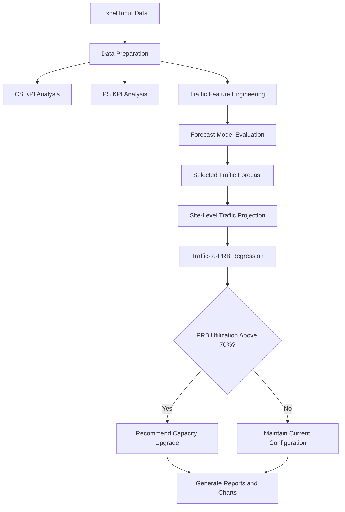
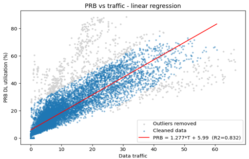
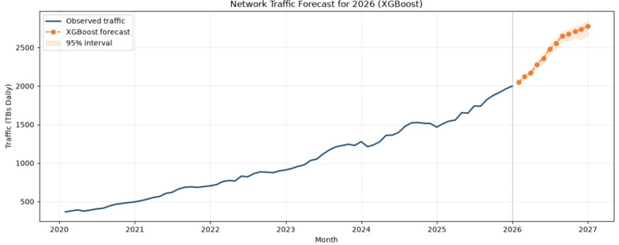
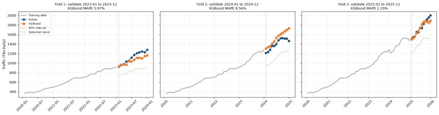
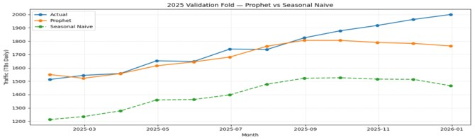
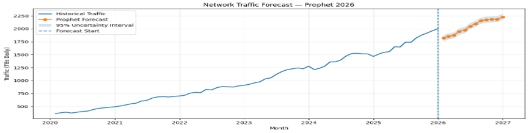
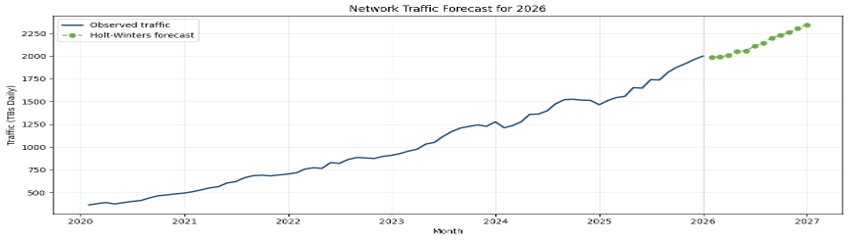
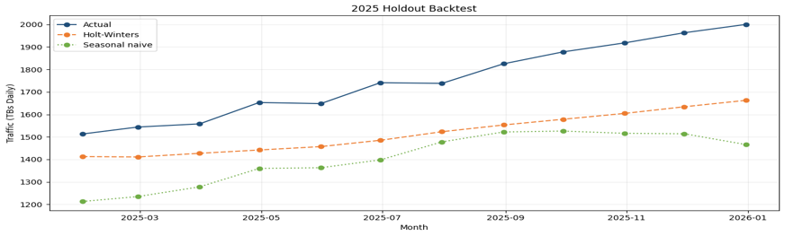

[README.md](https://github.com/user-attachments/files/33634690/README.md)
[README_Enhanced (2).md](https://github.com/user-attachments/files/33634654/README_Enhanced.2.md)
[README_Enhanced (1).md](https://github.com/user-attachments/files/33634236/README_Enhanced.1.md)
[README_Enhanced.md](https://github.com/user-attachments/files/33634137/README_Enhanced.md)
 <div align="center">

# 📶 Telecom KPI Analysis, XGBoost Forecasting & Automated Capacity Planning


**An end-to-end telecom network engineering project for CS/PS KPI analysis, traffic forecasting, PRB utilization estimation, and automated site capacity planning.**

</div>

---

## 📋 Project Overview

Mobile network operators face increasing traffic demands that can lead to network congestion, reduced throughput, and degraded Quality of Service (QoS).

This project combines telecom KPI analysis, machine learning, time-series forecasting, and automated capacity planning to support data-driven network engineering decisions.

### Key Features

- **CS & PS KPI Analysis:** Analyze voice and mobile data network performance.
- **Traffic Forecasting:** Compare XGBoost, Prophet, Holt-Winters, and Seasonal Naive models.
- **Model Validation:** Evaluate forecasting accuracy using historical holdout folds.
- **PRB Utilization Regression:** Estimate downlink resource utilization from traffic.
- **Automated Capacity Planning:** Identify potentially congested sites and recommend configuration upgrades.
- **Visual Reporting:** Generate charts and Excel reports for engineering analysis.

---

## ⚙️ System Architecture



---

## 📊 Stage 1: Telecom KPI Analysis

The project analyzes network performance across the available regions:

`CAI` · `ALX` · `DEL` · `SIN` · `UPP`

### 1. Circuit-Switched (CS) KPI Analysis

The CS analysis focuses on voice network performance and service availability.

Key metrics may include:

- Call Setup Success Rate (CSSR)
- Call Drop Rate (CDR)
- Network Availability
- CS Traffic


### 2. Packet-Switched (PS) KPI Analysis

The PS analysis focuses on packet-switched mobile data performance.

Key metrics may include:

- Data Traffic
- PRB Downlink Utilization
- Throughput (Mbps)
- E-RAB Drop Rate
- Handover Success Rate


---

## 📈 Stage 2: PRB Resource Utilization Regression

Linear regression is used to model the relationship between traffic volume and Physical Resource Block (PRB) downlink utilization.

### Regression Model

The following equation was reported in the project analysis and should be verified against the final regression output.

\[
\text{PRB DL Utilization (\%)} = 1.277 \times \text{Traffic (GB)} + 5.99
\]

**Reported \(R^2 = 0.832\)**



### Why This Matters

The regression model helps estimate future resource utilization based on projected traffic, supporting early identification of sites that may require capacity upgrades.

**Important:** Traffic units must be consistent with those used to train the regression model. The reported equation and \(R^2\) value should be updated if the final model produces different results.

---

## 🔮 Stage 3: Traffic Forecasting and Model Evaluation

The project compares multiple forecasting algorithms to identify a suitable model for projecting network traffic.

### A. XGBoost Regressor

XGBoost is a gradient-boosting model that can learn nonlinear relationships between engineered time-series features and traffic volume.

The current project draft reports an overall mean MAPE of **5.57%**.

#### 2026 Traffic Forecast



#### Historical Validation



### B. Prophet

Prophet is an additive forecasting model designed to capture trends and seasonal patterns.

The current project draft reports an overall mean MAPE of **5.74%**.

#### 2023 Validation


#### 2024 Validation


#### 2025 Validation



#### 2026 Forecast



### C. Holt-Winters Exponential Smoothing

Holt-Winters models the level, trend, and seasonality of a time series.

The current project draft reports an overall mean MAPE of **11.33%**.

#### 2026 Forecast



#### 2025 Validation



### 🏆 Forecasting Model Comparison

The following metrics are taken from the existing project draft and should be checked against the latest validation results.

| Model | 2023 MAPE | 2024 MAPE | 2025 MAPE | Mean MAPE |
|---|---:|---:|---:|---:|
| **XGBoost** | 5.97% | 8.56% | 2.19% | **5.57%** |
| Prophet | 7.04% | 7.11% | 3.07% | 5.74% |
| Holt-Winters | 15.96% | 5.04% | 12.99% | 11.33% |
| Seasonal Naive | 25.35% | 20.58% | 19.45% | 21.79% |

**MAPE (Mean Absolute Percentage Error)** measures the average absolute percentage difference between actual and predicted traffic. Lower values indicate better accuracy on the evaluated data.

Based on the reported mean MAPE, XGBoost achieved the lowest average error among the listed models.

---

## ⚡ Stage 4: Automated Site Capacity Planning

The capacity-planning engine translates traffic projections into site-level resource utilization estimates and evaluates whether capacity upgrades may be required.

### Traffic Growth Projection

The project draft reports the following aggregate traffic figures:

| Metric | Reported Value |
|---|---:|
| December 2025 Baseline Traffic | 2,000 TB/day |
| December 2026 Forecast | 2,780.34 TB/day |
| Reported Year-over-Year Growth | 39.12% |

These figures must be verified against the final forecasting output before being treated as confirmed results.

### PRB Congestion Threshold

The draft implementation uses **70% PRB DL Utilization** as the threshold for identifying potentially congested sites.

The decision process is:

1. Estimate future traffic.
2. Convert the traffic projection into estimated PRB utilization.
3. Compare the estimated utilization with the configured threshold.
4. Recommend an appropriate upgrade when the threshold is exceeded.
5. Retain the current configuration when an upgrade is not indicated.

### Hardware Upgrade Strategy

The upgrade engine evaluates available site configuration options in sequence, according to the configuration mapping implemented in the project.

The intended strategy is to evaluate possible capacity improvements before recommending a new site or cell.

Possible configuration options include:

- Normal 3-sector configuration
- Normal 4-sector configuration
- FDD MIMO
- First-carrier TDD
- Second-carrier TDD
- TDD Massive MIMO
- New site or cell expansion

**Note:** The actual upgrade order must match the configuration mapping and decision logic in the final Python code.

---

## 🗂️ Repository Structure

```text
telecom-capacity-forecasting/
│
├── Capacity_Planning_GUI.ipynb
├── capacity_planning_app.py
├── requirements.txt
├── README.md
│
├── images/
│   ├── cs.png
│   ├── ps.jpg
│   ├── linear_regression.png
│   ├── xgboost_forecast_2026.jpg
│   ├── xgboost_validation.jpg
│   ├── prophet 2023 validation.jpg
│   ├── prophet 2024 validation.jpg
│   ├── prophet_2025_validation.jpg
│   ├── prophet_2026_forecast.png
│   ├── holtwinter_2026_forecasting.png
│   └── holtwinter_2025_validation.png
│
└── pipeline_outputs/
    ├── network_forecast.png
    ├── prb_regression.png
    ├── upgrades.png
    └── capacity_plan_dec2026.xlsx
```

**Important:** This structure is based on the project draft. Keep only the files and directories that actually exist in your repository. GitHub paths are case-sensitive, and image filenames must match exactly.

---

## 📥 Dataset Specifications

The draft pipeline expects an Excel workbook named:

`Project Data - Traffic & KPIs.xlsx`

The following table describes the expected data structure. Verify the exact sheet and column names against your actual workbook and Python code.

| Worksheet | Example Columns | Purpose |
|---|---|---|
| `Network Traffic` | `Date`, `Traffic` | Aggregate network traffic |
| `PS KPIs` | `Site ID`, `Region`, `Y-M`, `Data Traffic (GB)`, `PRB DL Utilization`, `Throughput (Mbps)` | Packet-switched site KPIs |
| `CS KPIs` | `Site ID`, `Region`, `Y-M`, `Availability`, `CDR`, `CSSR`, `CS Traffic - Total` | Circuit-switched site KPIs |
| `Sites Configurations` | `Site ID`, `Confgurations` | Site configuration mapping |

Sheet names and column names must match the actual workbook. For example, `Site_Cinfiguration` and `Sites Configurations` are not interchangeable.

---

## 💻 Installation and Setup

### 1. Clone the Repository

```bash
git clone https://github.com/eslamwaheed02/telecom-capacity-forecasting.git
cd telecom-capacity-forecasting
```

### 2. Create a Virtual Environment

```bash
python -m venv venv
```

### 3. Activate the Environment

**Windows PowerShell**

```powershell
.\venv\Scripts\Activate.ps1
```

**macOS / Linux**

```bash
source venv/bin/activate
```

### 4. Install Dependencies

```bash
pip install -r requirements.txt
```

---

## 🚀 How to Run

### Option 1: Run the Python Pipeline

```bash
python capacity_planning_app.py
```

### Option 2: Launch the Jupyter Notebook

```bash
jupyter notebook Capacity_Planning_GUI.ipynb
```

Use the actual script and notebook filenames available in the repository. These commands may need adjustment if your project uses different entry points.

---

## 📄 Output Artifacts

Depending on the implementation, the pipeline may generate the following outputs:

| Output | Description |
|---|---|
| `capacity_plan_dec2026.xlsx` | Excel report containing forecasting and capacity-planning results |
| `network_forecast.png` | Traffic forecast visualization |
| `prb_regression.png` | Traffic-to-PRB regression visualization |
| `upgrades.png` | Capacity upgrade visualization |

Generated files may not exist until the application has been executed successfully.

---

## 🎯 Project Objectives

This project demonstrates the integration of:

- Telecom network KPI analysis
- Machine learning for traffic forecasting
- Time-series model comparison and validation
- Traffic-to-resource utilization regression
- Rule-based network capacity planning
- Automated engineering reporting

The goal is to support proactive capacity management through data-driven analysis and forecasting.

---

## 📜 License

This project is intended to use the MIT License if a corresponding `LICENSE` file is included in the repository.
