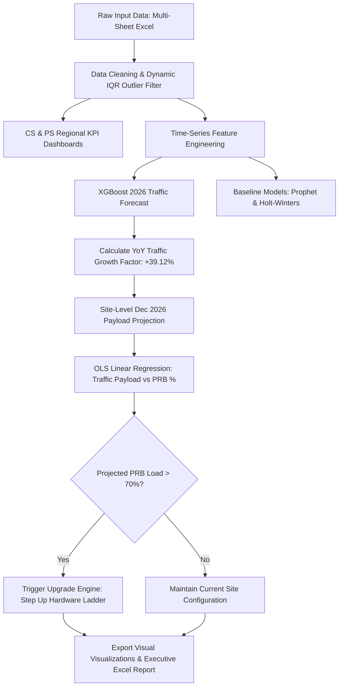

[README_telecom_capacity_forecasting (2).md](https://github.com/user-attachments/files/33633839/README_telecom_capacity_forecasting.2.md)
[README.md](https://github.com/user-attachments/files/33633741/README.md)

```markdown
<div align="center">

# 📶 Telecom KPI Analysis, XGBoost Forecasting & Automated Capacity Planning Engine


**An end-to-end AI/ML network engineering framework for Circuit-Switched (CS) and Packet-Switched (PS) KPI analysis, multi-model traffic forecasting, PRB resource regression, and automated site configuration upgrade planning.**

---

</div>

## 📋 Executive Overview

Mobile network operators face rapidly growing data traffic demands. Expanding physical site infrastructure without predictive modeling leads to inefficient Capital Expenditure (CapEx), while delayed upgrades cause cell congestion and degraded Quality of Service (QoS). 

This repository delivers an automated telecom capacity planning pipeline:
1. **Multi-Layer KPI Assessment**: Evaluates 2G/3G Voice metrics (CSSR, CDR, Availability) and 4G Data performance (Throughput, PRB Utilization, E-RAB Drop Rate, Handover Success Rate) across 5 geographic regions.
2. **Multi-Model Time-Series Forecasting**: Evaluates **XGBoost Regressor**, **Meta Prophet**, and **Holt-Winters Exponential Smoothing** across expanding-window backtesting folds to project 12-month traffic through December 2026.
3. **Resource Regression Modeling**: Maps payload growth to Physical Resource Block (PRB) Downlink Utilization using Ordinary Least Squares (OLS) regression after dynamic Interquartile Range ($1.5 \times \text{IQR}$) outlier cleaning ($R^2 = 0.832$).
4. **Automated Hardware Upgrade Engine**: Translates macro traffic forecasts down to site-level PRB utilization, evaluates cells against a **70% PRB congestion threshold**, and automatically steps site hardware up a 7-stage configuration ladder.

---

## ⚙️ End-to-End System Architecture



---

## 📊 Stage 1: Regional Network Health & KPI Analytics

Systematic evaluation of voice quality and data traffic distribution across geographical operational sectors (`CAI`, `ALX`, `DEL`, `SIN`, `UPP`):

### 1. Circuit-Switched (CS) Voice Performance Dashboard

---

### 2. Packet-Switched (PS) Mobile Data Dashboard

---

## 📈 Stage 2: PRB Resource Utilization Regression Modeling

To map forecasted traffic payload back to cell capacity load, we build an Ordinary Least Squares (OLS) linear regression model mapping monthly site data traffic (GB) to Downlink PRB Utilization (%).

### Mathematical Formulation

$$\text{PRB Downlink Utilization (\%)} = 1.277 \times \text{Traffic (GB)} + 5.99 \quad (R^2 = 0.832)$$

* **Outlier Purging**: Applying a $1.5 \times \text{IQR}$ residual filter removes drive-test anomalies and maintenance outages, establishing an accurate baseline correlation.

---

## 🔮 Stage 3: Time-Series Traffic Forecasting & Model Evaluation

Candidate algorithms were backtested over 3 expanding-window historical holdout folds (2023, 2024, 2025) to select the primary forecasting engine for 2026.

### A. XGBoost Regressor (Selected Primary Model)

Demonstrates superior accuracy with an overall mean MAPE of **5.57%**, effectively modeling non-linear seasonal spikes and exponential traffic acceleration.

| Headline: 2026 Traffic Forecast | Headline: Expanding-Window Cross-Validation |
| --- | --- |
|  |  |
| *Figure 4a: Projected 2026 daily network traffic with 95% confidence bands.* | *Figure 4b: Model validation against actual ground truth over 2023, 2024, and 2025.* |

---

### B. Meta Prophet Model

Additive time-series model capturing multi-period seasonality and long-term trend uncertainty (**Overall Mean MAPE: 5.74%**).

#### Historical Holdout Backtest Folds:

| Headline: 2023 Fold | Headline: 2024 Fold | Headline: 2025 Fold |
| --- | --- | --- |
|  |  |  |
| *Figure 5b: Prophet 2023 holdout.* | *Figure 5c: Prophet 2024 holdout.* | *Figure 5d: Prophet 2025 holdout.* |

---

### C. Holt-Winters Exponential Smoothing

Triple exponential smoothing capturing baseline level, trend, and multiplicative seasonality (**Overall Mean MAPE: 11.33%**).

| Headline: Holt-Winters 2026 Projection | Headline: 2025 Holdout Backtest |
| --- | --- |
|  |  |
| *Figure 6a: Holt-Winters 2026 projected traffic trajectory.* | *Figure 6b: 2025 holdout validation performance.* |

---

### 🏆 Benchmark Model Scorecard

| Model | 2023 Fold MAPE | 2024 Fold MAPE | 2025 Fold MAPE | **Overall Mean MAPE** | Model Status |
| --- | --- | --- | --- | --- | --- |
| **XGBoost Regressor** | **5.97%** | 8.56% | **2.19%** | **5.57%** | **Selected Production Engine** |
| Prophet Model | 7.04% | **7.11%** | 3.07% | **5.74%** | Secondary Baseline |
| Holt-Winters | 15.96% | 5.04% | 12.99% | **11.33%** | Under-predicts peaks |
| Seasonal Naive | 25.35% | 20.58% | 19.45% | **21.79%** | Benchmark Baseline |

---

## ⚡ Stage 4: Automated Site Capacity Upgrade Strategy

Converting macro traffic predictions into actionable site-level hardware upgrade recommendations:

$$\text{Dec 2025 Baseline Traffic (2,000 TB/day)} \xrightarrow{\text{XGBoost +39.12\% YoY}} \text{Dec 2026 Forecast (2,780.34 TB/day)}$$

### Hardware Upgrade Hierarchy Ladder

When a site cell's projected load exceeds the **70% PRB DL Utilization threshold**, the decision engine advances its hardware layout step-by-step to optimize CapEx before recommending physical site expansions:

$$\text{Step 1: Normal 3 Sectors} \longrightarrow \text{Step 2: Normal 4 Sectors}$$

$$\downarrow$$

$$\text{Step 3: TDD 1st Carrier} \longrightarrow \text{Step 4: TDD 2nd Carrier}$$

$$\downarrow$$

$$\text{Step 5: TDD Massive MIMO} \longrightarrow \text{Step 6: FDD Massive MIMO}$$

$$\downarrow$$

$$\text{Step 7: Physical Site Expansion / New Cell Build}$$

---

## 🏗 Repository Structure

```text
telecom-capacity-forecasting/
├── Capacity_Planning_GUI.ipynb   # Interactive Jupyter Notebook dashboard GUI
├── capacity_planning_app.py      # Automated CLI pipeline execution script
├── requirements.txt              # Environment dependencies
├── README.md                     # Project documentation
├── images/                       # Local image assets directory
│   ├── cs.png
│   ├── ps.jpg
│   ├── linear_regression.png
│   ├── xgboost_forecast_2026.jpg
│   ├── xgboost_validation.jpg
│   ├── prophet 2023 validation.jpg
│   ├── prophet 2024 validation.jpg
│   ├── prophet_2025_validation.jpg
│   ├── prophet_2026_forecast.png
│   ├── holtwinter_2026_forecasting.png
│   └── holtwinter_2025_validation.png
└── pipeline_outputs/             # Automatically generated at runtime
    ├── network_forecast.png
    ├── prb_regression.png
    ├── upgrades.png
    └── capacity_plan_dec2026.xlsx # Multi-sheet executive Excel report

```

---

## 📥 Dataset Specifications

Place `Project Data - Traffic & KPIs.xlsx` in the root repository directory. Expected worksheets:

| Sheet Name | Required Columns | Description |
| --- | --- | --- |
| `Network Traffic` | `Date`, `Traffic` | Daily aggregate network payload in Terabytes (TB). |
| `PS KPIs` | `Site ID`, `Region`, `Y-M`, `Data Traffic (GB)`, `PRB DL Utilization`, `Throughput (Mbps)` | Monthly site Packet-Switched metrics. |
| `CS KPIs` | `Site ID`, `Region`, `Y-M`, `Availability`, `CDR`, `CSSR`, `CS Traffic - Total` | Monthly site Circuit-Switched voice metrics. |
| `Sites Configurations` | `Site ID`, `Confgurations` | Base site configurations and sector layouts. |

---

## 💻 Installation & Setup

```bash
# 1. Clone repository
git clone [https://github.com/hatemhamid/Telecom-kpi-analysis-and-capacity-planning.git](https://github.com/hatemhamid/Telecom-kpi-analysis-and-capacity-planning.git)
cd Telecom-kpi-analysis-and-capacity-planning

# 2. Create and activate virtual environment
python -m venv venv
# On Windows:
venv\Scripts\activate
# On Mac/Linux:
source venv/bin/activate

# 3. Install dependencies
pip install -r requirements.txt

```

---

## 🚀 How to Run

```bash
# Option 1: Run complete background pipeline via CLI
python capacity_planning_app.py

# Option 2: Launch interactive GUI in Jupyter Notebook
jupyter notebook Capacity_Planning_GUI.ipynb

```

---

## 📄 Output Artifacts & Executive Reports

Running the application generates a `pipeline_outputs/` folder containing:

* **`capacity_plan_dec2026.xlsx`**: Multi-tab workbook with Executive Summary, Monthly Forecasts, Site Upgrade Recommendations, and Regional KPI metrics.
* **`upgrades.png`**: Post-forecast site PRB load distribution histograms and upgrade step breakdown charts.

---

## 📜 License

Distributed under the MIT License. See `LICENSE` for details.

```

<ElicitationsGroup>
  <Elicitation prompt="Show me how to create an automated GitHub Actions workflow to validate README markdown files." title="Setup GitHub Actions markdown check?"/>
  <Elicitation prompt="Generate a clean LICENSE file for this project." title="Generate LICENSE file?"/>
</ElicitationsGroup>

```
