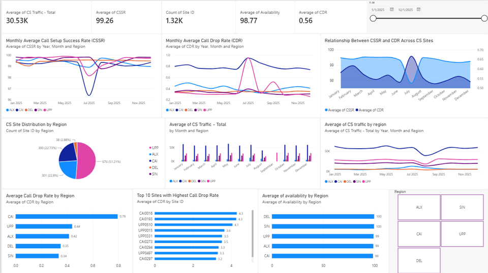
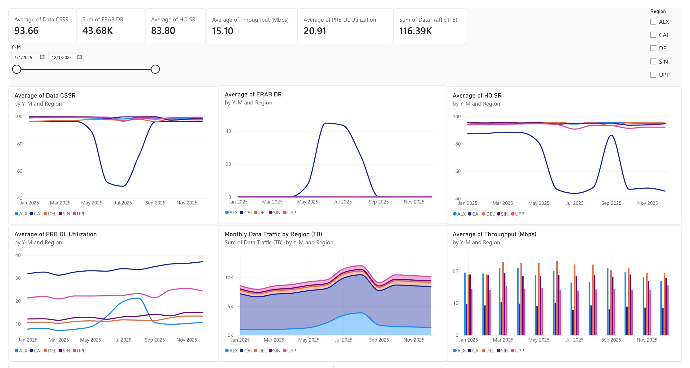

<div align="center">

# 📶 Telecom KPI Analysis, XGBoost Forecasting & Capacity Planning


**An end-to-end AI/ML network planning application for Circuit-Switched (CS) and Packet-Switched (PS) KPI analysis, time-series data forecasting, PRB utilization modeling, and automated site upgrade decisions.**

---

</div>

## 📊 1. Network KPI Analysis (CS & PS Layers)

### Circuit-Switched (CS) & Packet-Switched (PS) Performance Dashboards
Visual exploration of voice quality metrics (CSSR, CDR, Availability) and mobile data performance (Throughput, PRB Utilization, Data Traffic, Handover Success Rate):

| Circuit-Switched (CS) KPIs Analysis | Packet-Switched (PS) KPIs Analysis |
| :---: | :---: |
|  |  |

---

## 📈 2. PRB Utilization Modeling (Linear Regression)

Ordinary Least Squares (OLS) linear regression mapping monthly data traffic payload (GB) to Downlink PRB Utilization (%) after removing statistical outliers using $1.5 \times \text{IQR}$ residual filtering:

<div align="center">
  
</div>

$$\text{PRB Downlink Utilization (\%)} = 1.277 \times \text{Traffic (GB)} + 5.99 \quad (R^2 = 0.832)$$

---

## 🔮 3. Time-Series Traffic Forecasting Models

We evaluated three candidate time-series models using expanding-window cross-validation across historical holdout periods (2023–2025) to project 2026 network demand.

### A. XGBoost Regressor (Selected Primary Model)
Demonstrates superior accuracy with an overall mean MAPE of **5.57%**, effectively capturing non-linear surges and traffic acceleration.

| 2026 Traffic Forecast | Expanding-Window Cross-Validation |
| :---: | :---: |
|  |  |

---

### B. Prophet Model (Decomposable Additive / Multiplicative)
Provides robust uncertainty bounds (95% CI) and stable long-term trend modeling with an overall mean MAPE of **5.74%**.

| Prophet 2026 Forecast | Prophet 2025 Holdout Validation |
| :---: | :---: |
|  |  |

---

### C. Holt-Winters Exponential Smoothing
Triple exponential smoothing capturing baseline level, linear trend, and additive seasonality (Mean MAPE: **11.33%**).

| Holt-Winters 2026 Forecast | Holt-Winters 2025 Holdout Validation |
| :---: | :---: |
|  |  |

---

## 🏆 Model Benchmark Summary

| Model | 2023 MAPE | 2024 MAPE | 2025 MAPE | **Overall Mean MAPE** | Status |
| :--- | :---: | :---: | :---: | :---: | :--- |
| **XGBoost Regressor** | **5.97%** | 8.56% | **2.19%** | **5.57%** | **Selected Engine** |
| Prophet Model | 7.04% | **7.11%** | 3.07% | **5.74%** | Baseline |
| Holt-Winters | 15.96% | 5.04% | 12.99% | **11.33%** | Under-predicts surges |
| Seasonal Naive | 25.35% | 20.58% | 19.45% | **21.79%** | Benchmark Baseline |

---

## 🏗️ Repository File Structure

```text
telecom-capacity-forecasting/
├── Capacity_Planning_GUI.ipynb  # Interactive Jupyter Notebook dashboard
├── capacity_planning_app.py     # Standalone Python CLI execution script
├── requirements.txt             # Python environment dependencies
├── README.md                    # Project Documentation
├── images/                      # Presentation slides and model charts
│   ├── cs.png
│   ├── ps.jpg
│   ├── linear regression equation .png
│   ├── XGboost forecast 2026.jpg
│   ├── XGboost Validation.jpg
│   ├── prophet 2026 forecast.png
│   ├── prophet 2025 validation.jpg
│   ├── holtwinter 2026 forecasting.png
│   └── holtwinter 2025 validation.png
└── pipeline_outputs/            # Generated automatically at runtime
    ├── network_forecast.png
    ├── prb_regression.png
    ├── upgrades.png
    └── capacity_plan_dec2026.xlsx
